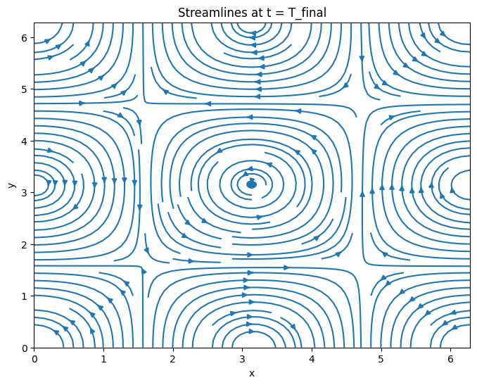
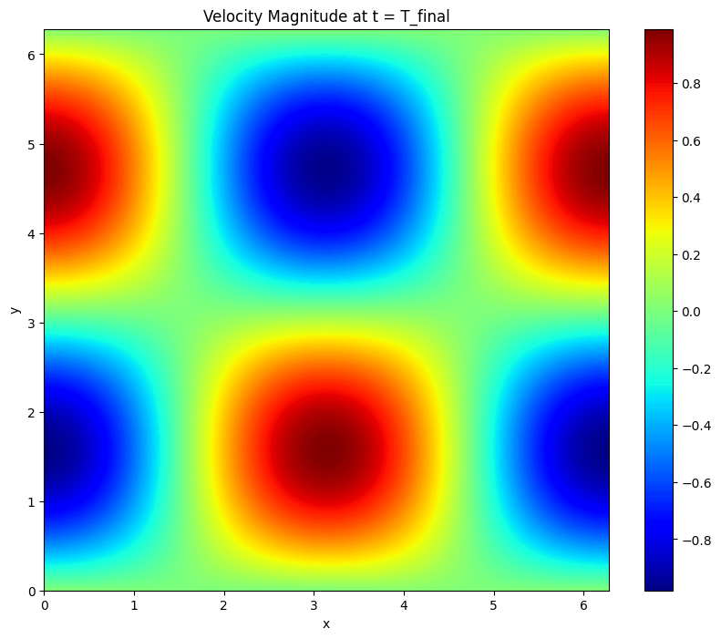
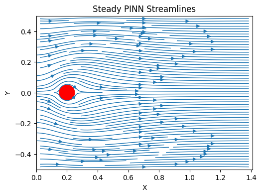
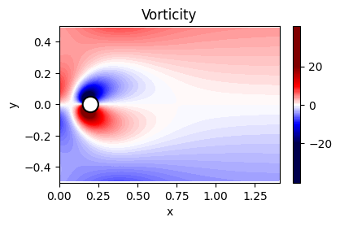

# Physics-Informed Neural Networks for Fluid Flow

Two physics-informed neural network (PINN) implementations that solve the incompressible Navier–Stokes equations directly from the governing PDEs, with no CFD training data — only the physics, boundary conditions, and (where available) an analytical solution for validation.

| Project | Problem | Method |
|---|---|---|
| [`taylor-green-vortex-pinn/`](./taylor-green-vortex-pinn) | 2D unsteady decaying vortex, Re = 100 | Time-dependent PINN, SOAP + L-BFGS |
| [`cylinder-flow-pinn/`](./cylinder-flow-pinn) | 2D steady flow past a cylinder, Re = 20 | Steady-state PINN, Adam + L-BFGS |

Both networks take spatial (and, for the vortex case, temporal) coordinates as input and predict velocity and pressure fields `(u, v, p)` directly, trained by minimizing the residual of the Navier–Stokes equations at collocation points plus boundary/initial-condition losses — the standard PINN formulation (Raissi et al.).

## Taylor-Green Vortex

  
  

An exact solution exists for this case, which makes it a clean benchmark for PINN accuracy. The trained network reaches a relative L2 error of **~1.6%** on both velocity components at the final time, and tracks the exact kinetic-energy decay curve closely. Details, equations, and all training curves: [`taylor-green-vortex-pinn/README.md`](./taylor-green-vortex-pinn/README.md).

## Flow Past a Cylinder

  
  

A steady, low-Reynolds-number (Re = 20) channel flow around a circular obstacle, with a parabolic inlet profile and no-slip walls/cylinder. The network recovers the expected recirculation bubble behind the cylinder and the pressure buildup on its upstream face. Details: [`cylinder-flow-pinn/README.md`](./cylinder-flow-pinn/README.md).

## Stack

PyTorch, automatic differentiation for the PDE residuals, Adam/SOAP for first-stage optimization, L-BFGS for fine-tuning convergence.
