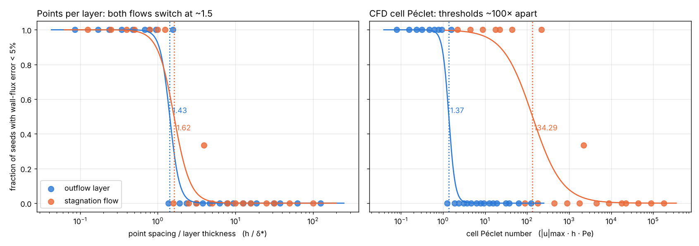
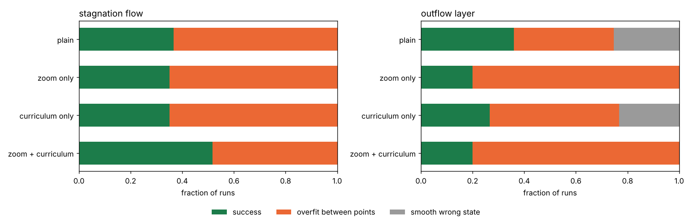

# When does a PINN miss a boundary layer?

A controlled study of physics-informed neural networks (PINNs) on advection–diffusion boundary layers, written in JAX. The question: can you predict, **before training**, whether a PINN will get a thin boundary layer right?

**Answer, from 1,254 training runs:** a plain PINN gets the wall flux wrong once the **spacing between collocation points exceeds about 1.5 layer thicknesses**. The same threshold holds in two different flows. The classical CFD criterion, the cell Péclet number, does not transfer: its threshold moves by a factor of about 100 between the two flows.

## Problem setup

Steady advection–diffusion, `u · ∇c = (1/Pe) Δc`, on the unit square, with exact solutions:

| Flow | Velocity | Layer thickness | Exact solution |
|---|---|---|---|
| Stagnation-point flow | `u = (x, −y)`, wall at `y = 0` | `~ 1/√Pe` | `c = erf(y√(Pe/2)) / erf(√(Pe/2))` |
| Outflow layer | `u = (1, 0)`, wall at `x = 1` | `~ 1/Pe` | `c = sin(πy) f(x)` |
| 1D (first study) | `u = 1` | `1/Pe` | `c = (e^{Pe(x−1)} − e^{−Pe}) / (1 − e^{−Pe})` |

- **Success metric:** the wall flux `∂c/∂n` at the wall (the heat or mass transfer), within 5%. The global L2 error can hide a wrong layer: 23 runs pass a 5% L2 test with a wrong wall flux.
- **Two candidate predictors** for an `n × n` grid (spacing `h = 1/n`):
  - points per layer: `h / δ*`, with `δ*` the slope thickness of the layer;
  - CFD cell Péclet number: `|u|max · h · Pe`.

## Model & training

- Fully connected network, 4 hidden layers × 64, tanh activations
- Loss = mean squared PDE residual at the collocation points + boundary-condition loss (no data)
- Adam for 10,000 steps, then L-BFGS for 5,000 steps; identical budget for every run
- Training loops compiled with `jax.lax.scan` and `jax.jit`; whole trainings vectorised over Péclet numbers and seeds with `jax.vmap`
- 2D sweep: 495 runs on two Kaggle T4 GPUs (9.9 h), strict FP32

## Results

**Which rule predicts failure?** Each dot is one (Pe, grid) case, with the fraction of 3 seeds that succeed. In points per layer the two flows switch at the same place (1.43 and 1.62). In cell Péclet they are 1.37 and 134.

| | Points per layer `h/δ*` | Cell Péclet |
|---|---|---|
| 50% success, outflow layer | 1.43 | 1.37 |
| 50% success, stagnation flow | 1.62 [1.53–1.98] | 134 [112–194] |
| Pooled AUC | **0.99** | 0.83 |

Once `h/δ*` is in a logistic model, adding cell Péclet does not help (likelihood ratio 1.5, p = 0.23). The reverse adds a lot (LR 98, p = 4×10⁻²³).

**A small loss is not a correct answer.** At Pe = 10⁴ on a 16×16 grid, the plain PINN reaches a training loss of 6×10⁻⁸ while its wall flux is 67% wrong: no collocation point lies inside the layer (the nearest row is 2.5 layer thicknesses from the wall). Of the plain-PINN runs with loss below 10⁻⁴, 62 of 109 are wrong.

## The fix: zoomed coordinate + Pe-curriculum

1. **Zoomed input.** Besides `(x, y)`, the network gets the distance to the wall in layer thicknesses, `η = y√(Pe/2)` (the inner variable of boundary-layer theory). In `y` the layer is 1% of the domain and a tanh network would need weights around 100 to draw it; in `η` it spans about two units, the network's natural scale.
2. **Pe-curriculum.** Adam runs in five stages with Pe rising geometrically (251 → 631 → 1,585 → 3,981 → 10,000), each stage starting from the previous weights; L-BFGS then runs at the target Pe.

Same network, points and budget. On the stagnation flow at Pe = 10⁴, 16×16: **wall-flux error 67% → 5%**. Over the whole study: 12 wins, 3 losses in paired comparisons (McNemar p = 0.035). Each ingredient alone does almost nothing.

On the outflow layer the fix lowers the global error but not the wall flux (0 wins, 6 losses): the zoomed input `(1 − x)·Pe` is not normalised there and saturates the network.

## 1D study

The first part of the project ([`1d-study/`](./1d-study)): 759 runs on `c′ = c″/Pe`. Failure is controlled by `Pe/N` with a threshold near 2.5, close to the CFD limit of 2. A second failure appears at Pe ≥ 1000: the loss has an exact straight-line minimum (loss = 1/3, found in 123 runs), and more points make it more likely. The zoomed coordinate plus curriculum wins 9 paired comparisons out of 9.

## Engineering note

The first 2D runs were about 30× too slow. Reading the compiled JAX program showed 64-bit matrix products inside an FP32 run: the L-BFGS line search promoted the parameters to FP64. A cast inside the loss fixed it (29 min → 6.3 min per batch) and made the full sweep fit in the GPU budget.

## Files

| Path | Content |
|---|---|
| `results/results_495_runs.csv` | One row per 2D training run: flow, method, Pe, grid size n, seed, wall-flux error, relative L2 error, residual gap, final loss |
| `results/make_figures.py` | Rebuilds the two figures above from the CSV (no training) |
| `1d-study/` | JAX code of the 1D study: sweep, plots, animations, robustness statistics |

## Limitations

Linear, steady problems with exact solutions; one architecture and training budget; 3 seeds per case; uniform collocation grids. The zoomed coordinate is close to existing work (BL-PINN, Arzani et al. 2023); the contribution here is the threshold rule, the comparison with the CFD criterion and the failure analysis. Next steps: rescaled zoomed input for the outflow layer, the nonlinear Burgers equation, and a robustness study over width, depth and random collocation.

## Stack

JAX, Optax, NumPy, pandas, scikit-learn, Matplotlib.
