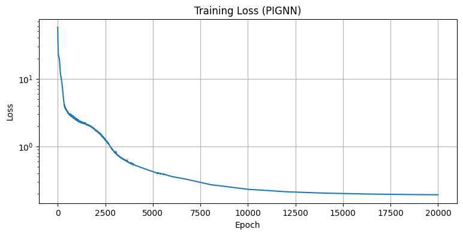
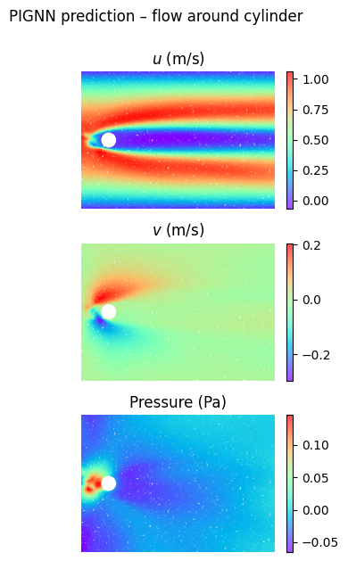
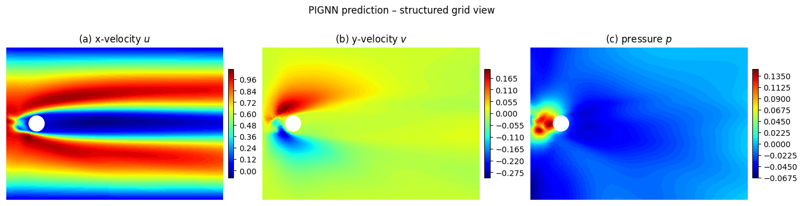
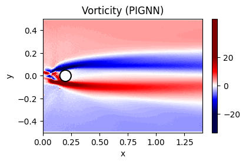
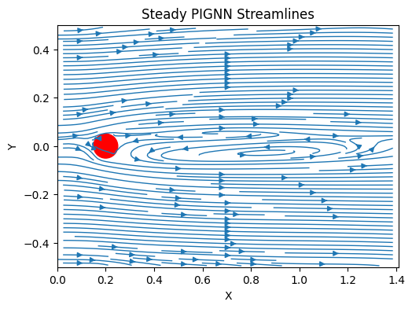

# Flow Past a Cylinder — Physics-Informed GNN (PIGNN)

An experiment that swaps the coordinate MLP of the [cylinder-flow PINN](../cylinder-flow-pinn) for a **message-passing graph neural network** on a point cloud, while keeping the same geometry, boundary conditions and loss weighting. Still no CFD training data — only the PDE residual and boundary conditions.

The interesting part is not the network but the derivatives: a GNN's output at a node depends on its neighbours, so `torch.autograd.grad` no longer gives the pointwise spatial derivative a PDE residual needs. The residual here is built from **precomputed graph differential operators** instead.

> **Status: exploratory.** The model learns a qualitatively sensible velocity field, but converges to a much higher loss than the PINN and the pressure field is poor. See [Results](#results) and [Limitations](#limitations).

## Problem setup

- Channel domain: `x ∈ [0, 1.41]`, `y ∈ [-0.5, 0.5]`, cylinder at `(0.2, 0)`, radius `R = 0.05` — same as the PINN project
- Parabolic (Poiseuille) inlet, zero-pressure outlet, no-slip on channel walls and cylinder surface
- Steady, non-dimensional incompressible Navier–Stokes:

```
continuity:   u_x + v_y = 0
x-momentum:   u u_x + v u_y + p_x = (1/Re)(u_xx + u_yy)
y-momentum:   u v_x + v v_y + p_y = (1/Re)(v_xx + v_yy)
```

- **`Re = 2000`** in this notebook, versus `Re = 20` in the PINN project. The two runs are therefore not a like-for-like benchmark.

## Method

### 1. Point cloud → graph

Interior collocation points, inlet, outlet, wall and cylinder points are concatenated into a single node set (7,089 nodes) and connected with a symmetric k-nearest-neighbour graph (`k = 14`, 198,492 directed edges). Boundary groups are just index ranges into the node array.

### 2. Why autograd is not enough

In a PINN, `u(x, y)` is a function of one input point, so `autograd.grad(u, x)` is exactly `∂u/∂x` at that point. In a GNN, `u_i` depends on the positions of neighbouring nodes through message passing; `autograd.grad(u, pos)` returns a vector–Jacobian product summed over nodes, not the local derivative at node `i`.

### 3. Graph differential operators (weighted least squares)

For every node, a local second-order Taylor model is fitted over its `k` neighbours:

```
u_j − u_i ≈ u_x·dx + u_y·dy + ½·u_xx·dx² + u_xy·dx·dy + ½·u_yy·dy²
```

solved in the inverse-distance-weighted least-squares sense (one batched 5×5 solve, done once before training). This yields fixed sparse operators `Gx, Gy, Gxx, Gyy` — the same idea as generalized finite differences in meshless solvers. They are linear in the field values, so gradients still flow back to the network weights.

A first version used a *linear* fit and obtained second derivatives by applying the gradient operator twice. Composing two first-order estimates on an irregular stencil was too noisy for the viscous term, which is what motivated the direct quadratic fit.

### 4. Network

- Encoder `Linear(2 → 48) + tanh` on node coordinates
- 3 message-passing layers: edge message from `(h_i, h_j, pos_i − pos_j)`, mean aggregation, residual node update
- Decoder `Linear(48 → 3)` → `(u, v, p)`
- 35,571 trainable parameters, implemented in plain PyTorch (`index_add_`), no PyTorch Geometric dependency

### 5. Loss and training

- Same composite loss and weights as the PINN (`w_pde=1, w_in=100, w_out=50, w_wall=50, w_cyl=50`), with spatial derivatives taken from the graph operators
- Adam, `lr = 1e-4`, halved every 2,000 epochs, gradient-norm clipping at 5.0, full-batch for 20,000 epochs (≈15 min on a Kaggle GPU)
- L-BFGS refinement afterwards (500 iterations max)

## Results

| | PINN ([`cylinder-flow-pinn`](../cylinder-flow-pinn)) | PIGNN (this folder) |
|---|---|---|
| Reynolds number | 20 | 2000 |
| Interior points | 20,000 | ≈3,500 (7,089 graph nodes in total) |
| Spatial derivatives | autograd (exact) | least-squares graph stencils (approximate) |
| First-stage training | Adam, 30,000 epochs (≈24 min) | Adam, 20,000 epochs (≈15 min) |
| Final training loss | 1.1e-2 | 1.9e-1 |

Because the Reynolds number and point count differ, the loss gap cannot be attributed to the architecture alone.

**Training loss** — fast initial drop, then a plateau around `0.19`. L-BFGS did not improve on it:



**Predicted fields** (u, v, pressure), evaluated on a fresh 60k-point cloud with its own k-NN graph:



**Fields on a regularized grid:**



**Vorticity** — two counter-signed shear layers leaving the cylinder:



**Streamlines** — a long recirculation region behind the cylinder:



What the figures show:

- The velocity field has the right structure: parabolic inlet profile, no-slip walls, a low-speed wake with reversed flow, and shear layers of opposite sign.
- The pressure field is the weakest output. It is noisy just upstream of the cylinder and does not show the clean stagnation-pressure build-up the PINN recovers.
- There is no reference solution in this notebook, so these are qualitative observations, not error measurements.

## Limitations

- **Not validated.** No CFD or analytical reference was used; only the training loss and visual plausibility.
- **Different Reynolds number from the PINN.** With `ν = 1/Re = 5e-4`, `D = 0.1` and a peak inlet velocity of 1, the diameter-based Reynolds number is about 200. That is above the onset of vortex shedding for a cylinder (around 47 in unconfined flow), so a steady formulation is likely the wrong model for this regime regardless of the network.
- **Approximate derivatives.** The stencil error does not vanish as the network trains, which probably sets a floor on the PDE residual. The operators were not tested against a function with known derivatives.
- **Loss terms were not logged separately**, so it is unknown whether the plateau comes from the PDE term or the boundary terms.
- **Train/inference graph mismatch.** Training uses `k = 14` on ~7k nodes; plots use `k = 8` on ~60k nodes. Mean aggregation makes this tolerable but it is a distribution shift.
- **Single run**, no seed control or hyperparameter sweep.

## What I would do next

1. Re-run at `Re = 20` with the PINN's point budget for a like-for-like comparison.
2. Unit-test the differential operators on an analytic field and measure their error against `k` and point density.
3. Log PDE and boundary losses separately; compare against a CFD reference.
4. Refine the point cloud near the cylinder and try hard-enforced boundary conditions.

## Files

- `cylinder_flow_pignn.ipynb` — full notebook with outputs (point cloud, graph, operators, model, training, plots)
- `images/` — exported output plots

Requires `torch`, `numpy`, `scipy`, `matplotlib`, `tqdm`.
