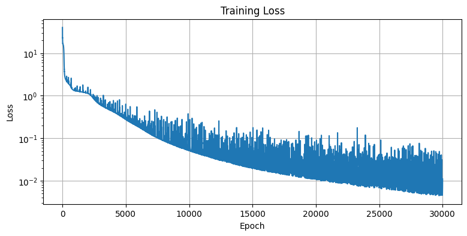
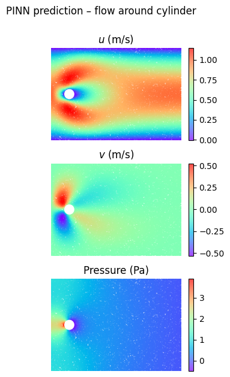
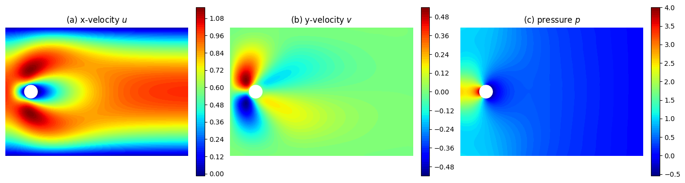
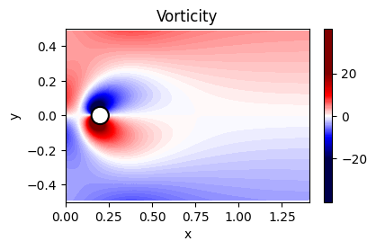
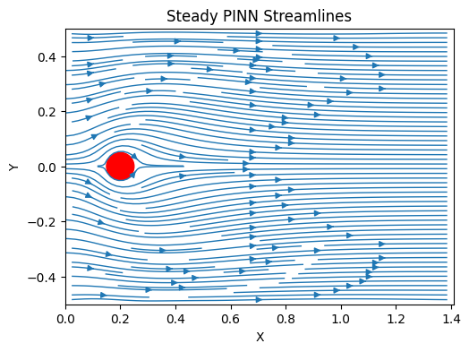

# Flow Past a Cylinder — PINN (Re = 20)

A physics-informed neural network that solves the steady 2D incompressible Navier–Stokes equations for flow past a circular cylinder in a channel — no CFD training data, only the PDE residual and boundary conditions.

## Problem setup

- Channel domain: `x ∈ [0, 1.41]`, `y ∈ [-0.5, 0.5]`
- Cylinder centered at `(0.2, 0)`, radius `R = 0.05`
- Re = 20 (non-dimensional), parabolic (Poiseuille) inlet profile, zero-pressure outlet, no-slip on channel walls and cylinder surface
- Governing equations (non-dimensional, steady):

```
continuity:   u_x + v_y = 0
x-momentum:   u u_x + v u_y + p_x = (1/Re)(u_xx + u_yy)
y-momentum:   u v_x + v v_y + p_y = (1/Re)(v_xx + v_yy)
```

## Model & training

- Fully-connected network, `[2, 64, 64, 64, 64, 3]` (input `x, y` → output `u, v, p`), tanh activations
- Collocation points sampled over the domain with cylinder interior points removed; separate point sets for inlet, outlet, walls, and cylinder surface
- Composite loss (PDE residual + inlet + outlet + wall + cylinder no-slip), with boundary terms up-weighted (`w_in=100, w_out=50, w_wall=50, w_cyl=50`) relative to the PDE term — this weighting was necessary to get the no-slip/inlet conditions to actually bind
- Optimizer: Adam for 30,000 epochs, then L-BFGS for final refinement

## Results

**Training loss** over 30k Adam epochs:



**Predicted fields** (u, v, pressure) after Adam training:



**Predicted fields after L-BFGS refinement** — visibly cleaner/less noisy than the Adam-only result above:


**Fields on a regularized grid** (interpolated for a smoother, paper-style presentation):



**Vorticity field** — the expected pair of counter-signed shear layers forms right at the cylinder surface:



**Streamlines** — showing the recirculation bubble immediately behind the cylinder:



## Files

- `cylinder_flow_pinn.ipynb` — full notebook (model, training loop, evaluation, plots)
- `images/` — exported output plots
