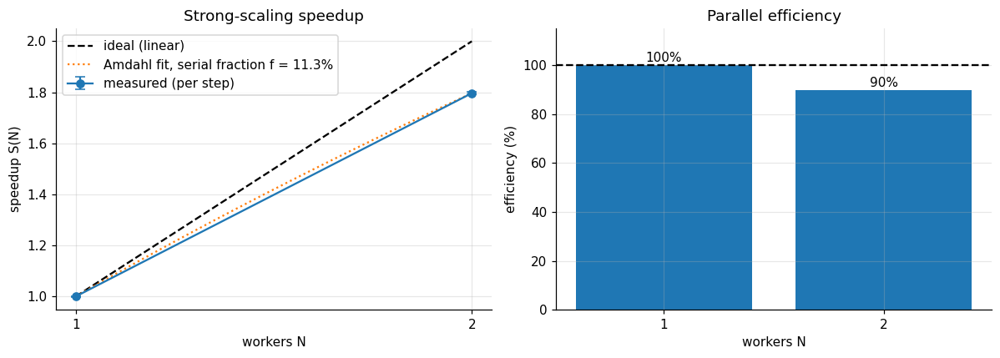
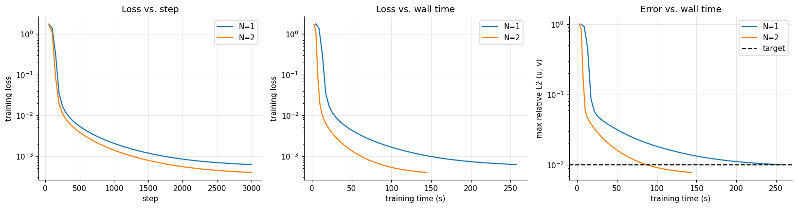
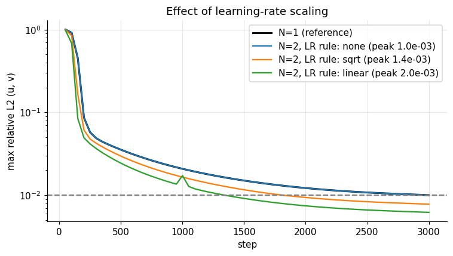

# Parallel PINN Training (HPC)

Multi-GPU distributed training of a **Navier–Stokes physics-informed neural network (PINN)** with **PyTorch `DistributedDataParallel`** (plus an optional **`mpi4py`** launch path), with a benchmark of **speedup, parallel efficiency and convergence** on 1 and 2 GPUs.

The PINN learns the 2D incompressible **Taylor–Green vortex**. The flow has an analytical solution, so every run is scored against the exact answer.

<p align="center">
  <br>
  
</p>

## Highlights

- **Launcher-agnostic distributed training.** The same `train.py` runs under `torchrun` or `mpirun`. Under MPI, `mpi4py` discovers ranks, derives each process's GPU from hostnames and broadcasts the rendezvous address to `torch.distributed`. The results below were produced with `torchrun`; the `mpirun` path is implemented but was not exercised in the reported runs (`mpi4py` was not installed on the Kaggle machine).
- **Fair scaling experiments.** All ranks build the same global point set and keep their own shard. In strong scaling, every GPU count therefore solves *exactly* the same problem.
- **Measured, not assumed.**
  - Strong and weak scaling, with synchronised timings.
  - Time-to-accuracy against the exact solution.
  - An Amdahl's-law fit.
  - Communication cost isolated with `DDP.no_sync()`.
  - A learning-rate scaling ablation (none / √N / linear).
- **Verified correctness.**
  - The exact solution gives a zero PDE residual.
  - 2-worker DDP gradients equal the single-process full-batch gradient, checked to ~1e-12 in the test suite on CPU.
  - Model replicas stay identical across ranks.
- **Physics design.** A periodic Fourier input embedding enforces the boundary conditions exactly, and the pressure gauge is fixed through the initial condition.

## Results

Measured on Kaggle's 2 × Tesla T4 runtime (single node, `torchrun`, NCCL backend). The executed run, with all logs and figures, is `notebooks/parallel_pinn_hpc_kaggle_run.ipynb`; the short summary is in `figures/summary.txt`.

**Strong scaling** — 32,768 global collocation points, split across the workers:

| Workers | Points per GPU | Step time (ms) | Speedup | Efficiency | Rel. L2 (u) | Rel. L2 (p) |
|:-:|:-:|:-:|:-:|:-:|:-:|:-:|
| 1 | 32,768 | 85.95 ± 0.18 | 1.00 | 100 % | 1.28e-2 | 0.22 |
| 2 | 16,384 | 47.84 ± 0.13 | 1.80 | 90 % | 9.87e-3 | 0.21 |

**Weak scaling** — 32,768 points *per GPU*, so 2 GPUs train on 65,536 points:

| Workers | Global points | Step time (ms) | Efficiency | Throughput (points/s) |
|:-:|:-:|:-:|:-:|:-:|
| 1 | 32,768 | 86.01 ± 0.09 | 100 % | 3.81e5 |
| 2 | 65,536 | 86.51 ± 0.17 | 99 % | 7.58e5 |

*Mean ± std over 3 seeds · 3000 Adam steps · 17,475-parameter network · errors against the exact solution*

**Learning-rate rule at 2 workers** (one seed):

| LR rule | Peak LR | Final rel. L2 (u) | Steps to L2 < 1e-2 | Time to L2 < 1e-2 (s) |
|:-:|:-:|:-:|:-:|:-:|
| none | 1.0e-3 | 1.00e-2 | not reached | not reached |
| √N (default) | 1.41e-3 | 7.80e-3 | 1,850 | 88.6 |
| linear | 2.0e-3 | 6.21e-3 | 1,350 | 64.4 |

<p align="center">
  
</p>

What the numbers say:

- **Two GPUs cut the step time by 1.80×** at fixed problem size, and doubling the problem on two GPUs costs almost nothing per step (99 % weak-scaling efficiency).
- **Communication is not the bottleneck.** The exposed all-reduce cost is about 1 % of a step; the 10 % efficiency loss in strong scaling comes from fixed per-step overheads on a half-size workload.
- **The accuracy gain at 2 workers comes from the learning rate, not from parallelism.** With the single-GPU learning rate, the 2-GPU run reproduces the 1-GPU error curve (the blue line overlaps the reference), as the gradient-equivalence test predicts.
- **Time-to-accuracy speedup is not available.** No single-GPU run reached the 1e-2 target within 3000 steps (the best ended at 1.001e-2), while 2 of 3 two-GPU seeds did (89 s and 120 s).

Caveats:

- **Two worker counts only.** The Amdahl fit (serial fraction 11.3 %, implied ceiling 8.8×) rests on a single speedup measurement and is an extrapolation, not a result.
- **Pressure is poorly resolved.** Relative L2 on pressure stays near 21 % in every run, against about 1 % on velocity.

## Method in brief

| Component | Choice |
|---|---|
| PDE | 2D incompressible Navier–Stokes, ν = 0.1, t ∈ [0, 1], periodic domain [0, 2π]² |
| Network | MLP 5 × 64, tanh, periodic Fourier embedding (k = 1, 2) |
| Loss | momentum + continuity residuals (autograd, 2nd order) + initial condition (u, v, p) |
| Parallelism | data parallel: DDP, NCCL on GPU and gloo on CPU; one process per GPU |
| Optimiser | Adam; peak LR scaled by √N; linear warm-up then cosine decay |
| Metrics | step time, speedup, efficiency, weak-scaling efficiency, time-to-accuracy, relative L2, communication fraction |

## Repository layout

```
parallel-pinn-hpc/
├── pinn_hpc/
│   ├── model.py          # PINN with periodic embedding
│   ├── physics.py        # Taylor–Green solution, NS residuals, loss, L2 error
│   ├── data.py           # seeded global sampling + per-rank sharding
│   ├── distributed.py    # torchrun / mpirun / single-process setup (mpi4py bootstrap)
│   └── analysis.py       # speedup, efficiency, Amdahl fit
├── train.py              # distributed training + timing + communication probe
├── benchmark.py          # sweep over worker counts, scaling modes, seeds
├── notebooks/
│   ├── parallel_pinn_hpc.ipynb             # theory, checks, benchmark, analysis, discussion (clean, runs anywhere)
│   └── parallel_pinn_hpc_kaggle_run.ipynb  # the same notebook as executed on Kaggle 2 × T4, with outputs
├── tests/                # physics + DDP-equivalence tests (CPU)
├── results/              # JSON results per run (regenerated by the benchmark; not committed)
└── figures/              # plots exported from the Kaggle run + summary.txt
```

## Quick start

```bash
pip install -r requirements.txt
pytest -q                                   # correctness tests (CPU is enough)

# single run
python train.py --steps 3000

# 4 GPUs
torchrun --standalone --nproc_per_node=4 train.py --scaling strong
mpirun -np 4 python train.py --scaling strong          # needs mpi4py + OpenMPI/MPICH

# full scaling sweep (what the notebook runs)
python benchmark.py --nprocs 1 2 4 --scaling strong weak --repeats 3 --steps 3000

# CPU smoke test, no GPU needed
python benchmark.py --nprocs 1 2 --scaling strong --device cpu --steps 100 --n_colloc 4096
```

Then open `notebooks/parallel_pinn_hpc.ipynb` and run all cells. On a machine with fewer than 2 GPUs, the notebook automatically switches to a reduced CPU configuration so the pipeline still runs end to end. Kaggle's free 2 × T4 GPU runtime is enough for the 1- and 2-GPU study.

## Key takeaways

- PINNs are small models trained on many points, so **data parallelism** is the right strategy. Gradients are cheap to exchange, but each GPU's workload shrinks in strong scaling, so fixed overheads eventually dominate.
- **Weak scaling** (more points per step as GPUs are added) is the regime where PINNs scale best, and denser sampling also helps accuracy.
- Report **time-to-accuracy**, not only time per step: N workers means an N× larger effective batch, and the learning rate must be adapted to it.

## Limitations and future work

Single-node study on 1 and 2 GPUs; `mpirun` launch implemented but not benchmarked; Adam only (L-BFGS does not map directly onto DDP); smooth laminar flow; pressure error remains high. Next steps: domain decomposition (XPINN/cPINN), multi-node runs on SLURM through `mpirun`, mixed precision, and residual-based adaptive sampling.

## License

MIT
