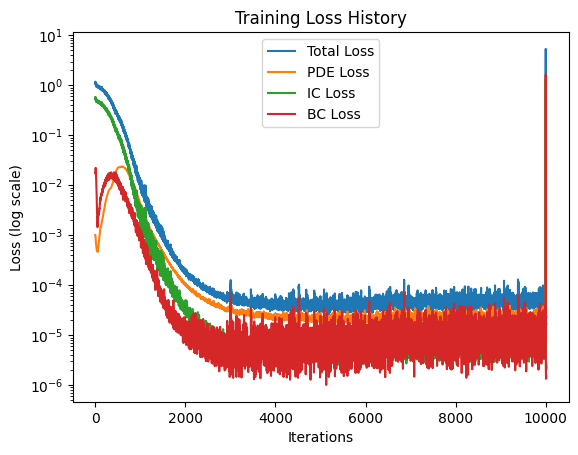
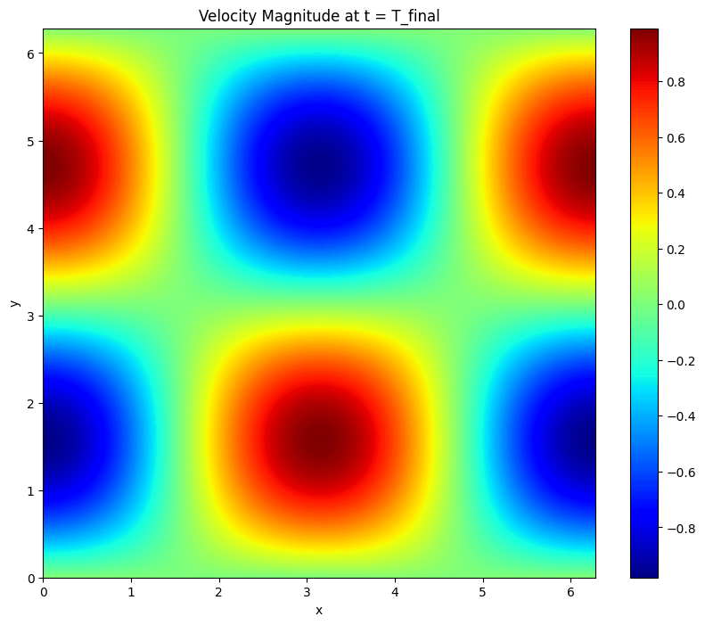
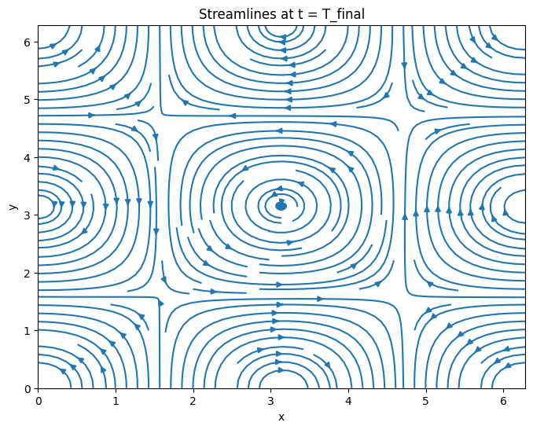
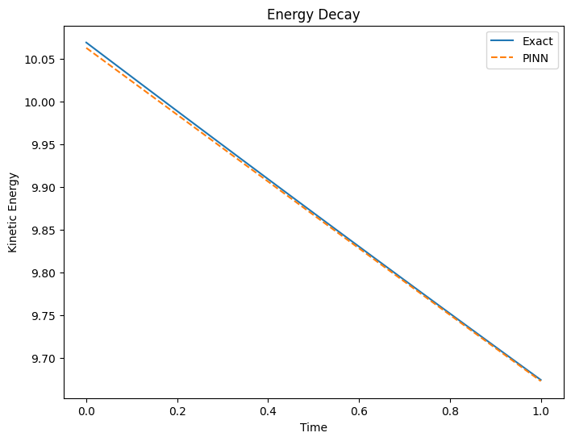
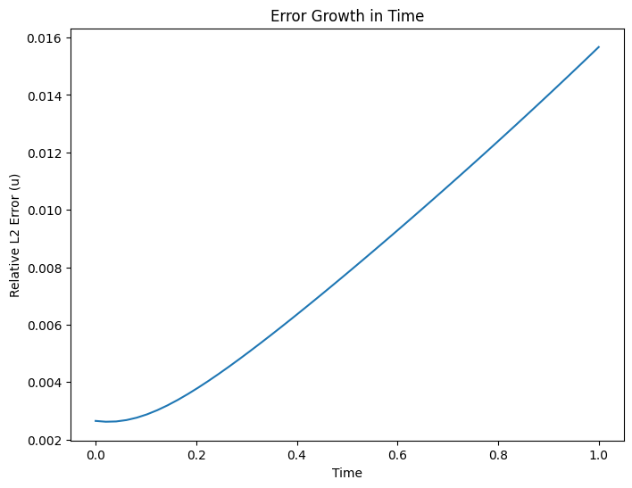

# Taylor-Green Vortex PINN

A physics-informed neural network that solves the 2D unsteady incompressible Navier–Stokes equations for the Taylor-Green vortex, a classic decaying-vortex benchmark with a known closed-form solution.

## Problem setup

- Domain: `x, y ∈ [0, 2π]`, `t ∈ [0, 1]`, periodic in space
- Viscosity `ν = 0.01` (Re = 100)
- Exact solution used for the initial condition and for validation:

```
u(x, y, t) = -cos(x) sin(y) e^(-2νt)
v(x, y, t) =  sin(x) cos(y) e^(-2νt)
p(x, y, t) = -0.25 (cos(2x) + cos(2y)) e^(-4νt)
```

## Model & training

- Fully-connected network, `[3, 30, 30, 30, 3]` (input `t, x, y` → output `u, v, p`), tanh activations
- Loss = PDE residual (momentum + continuity, via autograd) + initial-condition loss + periodic boundary-condition loss + a data-fitting term against the exact solution
- Optimizer: [SOAP](https://arxiv.org/abs/2409.11321) for 10,000 iterations, then L-BFGS refinement for final convergence
- All losses are tracked and plotted separately (total / PDE / IC / BC)

## Results

**Training loss** — all components decay from O(1) to ~1e-5, with the initial-condition and boundary losses converging faster than the raw PDE residual:



**Predicted velocity field at t = T_final**, compared against the checkerboard vortex pattern of the exact solution:



**Streamlines at t = T_final** — the network correctly recovers the array of counter-rotating vortices:



**Quantitative accuracy** at t = T_final:

| Quantity | Relative L2 error |
|---|---|
| u | 1.57% |
| v | 1.57% |

**Energy decay** — predicted kinetic energy closely tracks the exact decay curve over the full time horizon:



**Error growth over time** — error is smallest near t = 0 (where the IC loss anchors the solution) and grows roughly monotonically toward t = T_final:



## Files

- `taylor_green_vortex_pinn.ipynb` — full notebook (model, training loop, evaluation, plots)
- `images/` — exported output plots
